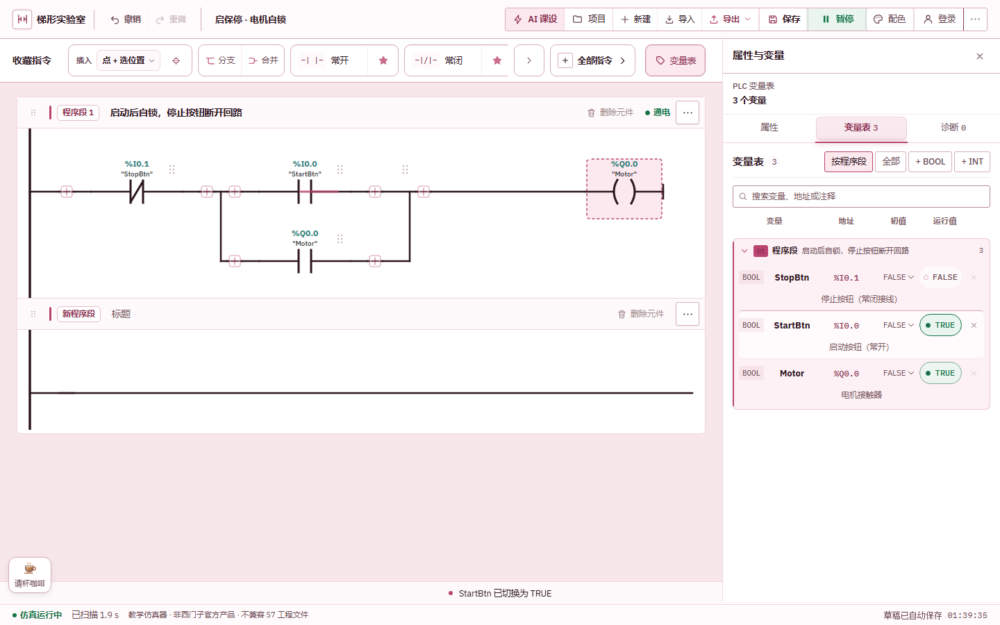

# LadderLab

[中文](README.md) | English

[](https://github.com/wakeup595626-cmyk/ladderlab/actions/workflows/ci.yml)
[](https://wakeup595626-cmyk.github.io/ladderlab/)
[](LICENSE)
[](package.json)

LadderLab is a Chinese-first, browser-based PLC ladder-logic teaching simulator. Build,
run, and inspect relay logic without installing TIA Portal or connecting to physical PLC
hardware.



> LadderLab is an independent educational project. It is not a Siemens product or an
> official replacement, and it does not import TIA Portal / SIMATIC S7 projects, proprietary
> instructions, or hardware configurations. Its V14/V21 instruction profiles represent
> documented teaching subsets, not complete reproductions of those software versions.

## What it does

- Author ladder programs with contacts, parallel branches, coils, function boxes, variable
  tables, compile diagnostics, and scan-cycle simulation.
- Use timers, counters, edge detection, and a focused integer instruction set.
- Start from 14 built-in teaching examples across course experiments, machine-design
  exercises, and introductory demonstrations.
- Save local projects as `.ladderlab.json`, export PNG/SVG diagrams, produce paginated PDF
  program sheets, and generate shareable project links.
- Derive a reference sequential-function view from recognisable step, state, or cycle
  patterns in the current ladder program.
- Install the web app for offline use after the first successful load.
- Optionally connect a user-owned Supabase project for account-based cloud storage.

The complete Chinese guide, shortcut reference, simulation semantics, and browser
acceptance workflow live in [docs/GUIDE.md](docs/GUIDE.md).

## Run locally

Node.js `^22.12`, `^24`, or `>=26` is required; odd-numbered releases such as 23 and 25 are
outside the supported range.

```bash
npm ci
npm run dev
```

Build and verification:

```bash
npm run build
npm run check
npm run test:e2e
```

`npm run check` runs unit tests, type checking, linting, and the production build. The E2E
suite uses Playwright.

## AI-assisted course design

The in-app **AI course design** panel is a prompt generator, not an automatic circuit
solver. It assembles the repository link, I/O requirements, state-table requirements, JSON
format, validation commands, and delivery boundaries into a prompt for a local coding
agent. The page does not call an AI service or upload the assignment text.

An agent can validate a generated project with:

```bash
node scripts/check-project.mjs path/to/project.ladderlab.json
node scripts/share-link.mjs path/to/project.ladderlab.json
```

Generated logic still needs simulation-based review. This workflow does not create SCL,
FBD, HMI, TIA Portal projects, or downloadable code for a physical PLC.

## Data boundaries

Without Supabase configuration, projects remain in the current browser and are not uploaded.
When the user configures and signs in to their own Supabase project, that account's projects
are synchronised to the selected project; share links, favourites, and interface preferences
remain local. Browser-site data removal also removes local projects, so important work should
be exported as `.ladderlab.json`.

## Safety and scope

LadderLab is for teaching, editing, and simulation. The derived SFC view is a reference
visualisation, not an authoritative translation. Interlocks, timing, and scan-order details
remain governed by the ladder program. The project does not communicate with real PLCs and
must not replace hardware commissioning, safety review, or instructor approval.

## Contributing and licence

See [CONTRIBUTING.md](CONTRIBUTING.md). Simulation changes should include tests; UI and
instruction-profile changes should explain their teaching purpose and limits. LadderLab is
released under the [MIT License](LICENSE). Siemens, SIMATIC, TIA Portal, and related marks
belong to their respective owners; this project is not affiliated with or endorsed by them.
