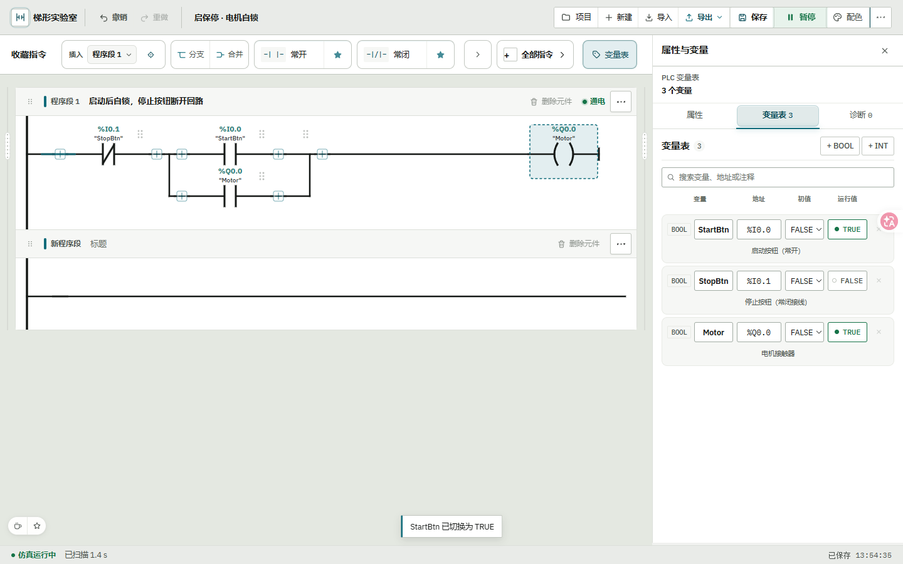

# 梯形实验室 LadderLab

在浏览器里编写、运行和观察 PLC 梯形图，不需要安装博途或连接真实 PLC。

[在线体验](https://wakeup595626-cmyk.github.io/ladderlab/) ·
[使用指南](docs/GUIDE.md) ·
[指令档案](docs/GUIDE.md#指令档案)



> LadderLab 是独立教学项目，不是西门子产品或官方替代品，也不兼容 TIA Portal /
> SIMATIC S7 工程文件、专有指令和硬件配置。项目中的“V14 / V21 档案”只表示本仿真器
> 开放的基础指令子集，不等于完整复刻对应版本。

## 能做什么

- 在可拖拽、可复制的程序段里放置触点、并联支路、线圈和指令盒，单击元件即可改参数。
- 用变量表、编译诊断和逐周期扫描观察能流；支持 TON / TOF / TONR、CTU、边沿和整数指令。
- 切换 V14 / V21 指令档案，运行六个课程实验，或从启保停、顺序启动等示例开始练习。
- 管理本机项目，导入/导出 .ladderlab.json，保存完整程序或纯梯形图 PNG。
- 安装为桌面应用；首次联网加载后可离线打开，工程数据保存在当前浏览器本机。

完整操作说明、快捷键、项目保存、离线安装、仿真语义和浏览器验收步骤见
[docs/GUIDE.md](docs/GUIDE.md)。

## 本地运行

需要 Node.js 22.12+、24.x 或 26+。23、25 这类奇数版本不在 engines 支持范围内。

```bash
npm ci
npm run dev
```

生产构建与预览：

```bash
npm run build
npm run preview
```

提交前可运行 npm run check，依次执行单元测试、类型检查、lint 和生产构建。涉及界面或
存储的改动还需按使用指南完成真实浏览器回归。

## 数据与边界

应用没有账号、数据库或云同步服务，不会自动把梯形图上传到服务器。清理浏览器站点数据
会删除本机工程，重要内容请导出 .ladderlab.json 备份。

本工具只用于浏览器内的教学编辑与仿真，不支持 SCL / SFC / FBD / HMI，不与真实 PLC
通信，也不能替代现场联调和安全验收。

## 支持作者

LadderLab 由个人利用业余时间维护，没有广告和内购。如果它帮你省下了一段调试时间，可以：

- 点页面常驻小浮标里的咖啡图标，用支付宝扫码支持；浮标可拖到界面任意位置，
  松手后会记住落点；
- 点浮标里的星标入口打开仓库，登录 GitHub 后点右上角 Star 即可（GitHub 不允许
  第三方网页代点，必须本人确认）；
- 到 [作者 GitHub 主页](https://github.com/wakeup595626-cmyk) 看看其他项目，或者提交
  Issue 反馈问题。

## 参与贡献与许可

欢迎提交问题和改进，请先阅读 [CONTRIBUTING.md](CONTRIBUTING.md)。仿真语义改动需要
附带测试，界面或指令档案改动需要说明教学用途和边界。

本项目采用 [MIT License](LICENSE)。西门子、SIMATIC、TIA Portal 等名称和商标归其各自
权利人所有；本项目与西门子公司没有隶属或背书关系。
