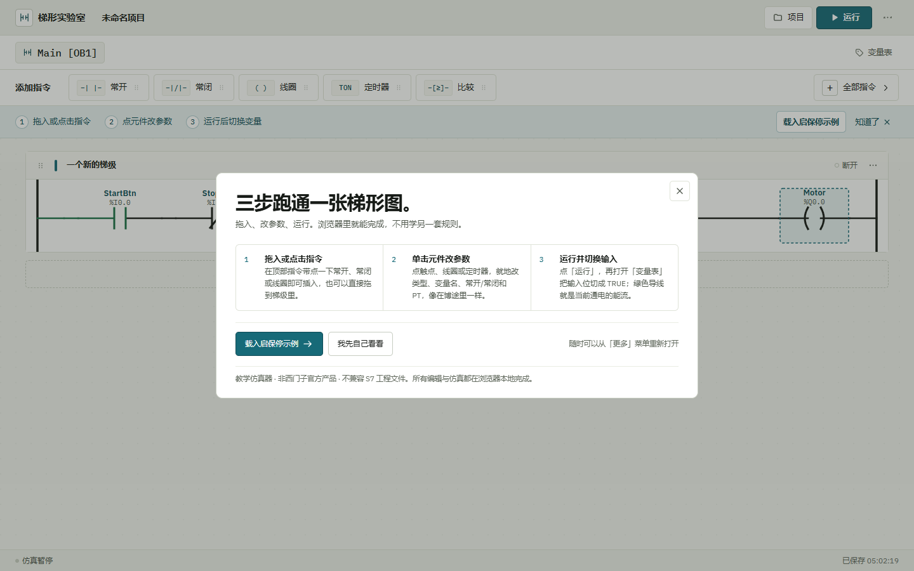
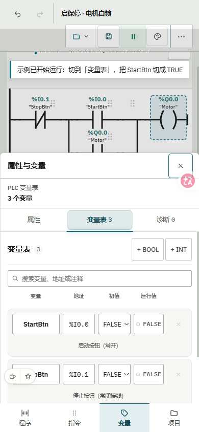

# LadderLab 使用指南

这份指南覆盖 LadderLab 的日常操作、安装与离线使用、工程保存、指令档案、仿真语义和
浏览器验收。只看最短上手流程，可以回到 [README](../README.md)。

在线地址：<https://wakeup595626-cmyk.github.io/ladderlab/>

## 三步上手



1. **拖入或点击指令**：顶部“收藏指令”默认放常开、常闭、线圈、定时器和比较。先在收藏条
   左侧的“插入到”里选好程序段，再点一下指令：触点会插在画布上选中的元件之后，没选
   元件就接在段末；连续点几下会按顺序往后串。线圈、定时器等输出类指令会替换目标段的
   输出。也可以直接拖到程序段里，拖到哪个“+”就落在哪里。需要别的指令时点“全部指令”，
   再点右侧星标把它收进顶栏。
2. **单击元件改参数**：点触点、线圈或定时器，就地修改类型、变量名、常开/常闭、地址、
   注释或定时器 PT。拖动元件即可换位，拖动程序段左侧手柄可调整顺序。选中元件后
   Ctrl+C / Ctrl+V 可按顺序复制粘贴。
3. **运行并切换输入**：点“运行”，再打开“变量表”，把输入位切成 TRUE；绿色导线就是
   当前扫描周期的通电状态。

首次进入是一张空白程序段，不会预置任何指令；梯形图上方会显示同一条三步教练条。点
“载入启保停示例”可立刻得到一个可运行、可拖动编辑的回路。之后可从右上角“更多”菜单
重新打开三步说明。

### 运行按钮怎么看结果

点“运行”后按钮变成绿色“暂停”，底部状态栏同时显示“仿真运行中”和“已扫描 0.9 s”，
这两处就是正在连续扫描的证据；再点一次就回到“仿真暂停”。扫描只会按当前输入反复计算
程序段，不会替你改变输入。想看到线圈得电，点运行提示里的“打开变量表”（或顶部的
“变量表”），把输入位切成 TRUE，导线和线圈会随扫描变绿。

如果工程有编译错误，按钮会变成红色的“无法运行”并标出错误数。点它不会假装运行，而是
直接打开诊断面板列出原因；修到 0 个错误后按钮恢复成“运行”。运行过程中如果改参数改出了
新错误，仿真会自动停下，状态栏同步变回“仿真暂停”。

### 收藏指令插到哪里

1. 顶部“插入到”下拉框选程序段；切换后画布会滚到那一段并短暂标出落点，约 2 秒后
   自动恢复正常，不会一直压在梯形图上。
2. 点画布上的元件，收藏触点会插在它后面；没选元件时插到段末、输出之前。顶部文字会
   跟着写清落点（如“常开 StartBtn 后”），高亮只在切换或定位时短暂出现。
3. 新触点插入后自动成为选中项，连续点击就按顺序往后串，形成一条串联回路。
4. 线圈、定时器、传送等输出类收藏卡带“替换”标记，点击会替换目标程序段原有的输出。
5. 收藏指令不会自动新建程序段；需要新段时点画布下方的“添加程序段”。
6. 想再看一次落点，点“插入到”右侧的“定位”；点画布空白处则立即收起提示。顶部的
   “程序段 N · 落点”文字始终保留，不展开高亮也不会丢目标。

收藏最多 8 条，保存在当前浏览器，刷新后仍然保留。

### 画一条并联分支

1. 点分叉位置的“+”，选“加入并联分支”；新支路会以虚线草稿出现。
2. 在新支路末尾的“+”继续加元件，想加多少就加多少。
3. 画完点支路右侧的“合并分支”，再点主线上要闭合的那个“合”插入点；按 Esc 可取消取点。

## 界面结构

- **顶栏**：左侧是撤销/重做和项目名称，右侧集中放“新建 / 导入 / 导出 / 保存 / 运行”
  主操作。导出菜单可选择工程文件、完整程序 PNG 或纯梯形图 PNG；手机端会把这组文件操作
  收进“文件”菜单。撤销快捷键是 Ctrl+Z，重做是 Ctrl+Shift+Z。
- **程序页签**：Main [OB1]，右侧可切换变量表。
- **收藏指令栏**：左侧常驻“插入到 程序段 N · 落点”的选择器；右边是收藏的指令卡和
  “全部指令”。在“全部指令”里点星标即可一键收藏或取消收藏，顺序按收藏先后排列；
  输出类卡片标有“替换”，表示它会替换该段输出。窗口变窄或打开变量面板后一屏放不下时，
  指令条尾部出现“›”，点一下向右翻，翻到末尾再点回到开头。
- **梯形图工作区**：每段固定显示“程序段 1 / 2 / 3…”，编号后是可点击修改的标题、元件、
  并联支路和添加程序段入口；编号随拖动排序自动重排。
- **状态栏**：运行状态、已扫描时间、错误数和本地保存时间。
- **按需抽屉**：项目、变量表、实验库、帮助和说明只在需要时打开。

程序图纸默认以 1360px 居中显示。纸面两侧的扩展带使用比应用底色更深的专用底色，把
指针移到图纸左、右边缘，拖动竖向调宽抓手即可加宽或收窄；双击抓手（或聚焦后按 Home）
恢复默认宽度，方向键可微调。手机端自动铺满可用宽度，并把“程序 / 指令 / 变量 / 项目”
放在底部导航中。



## 项目、文件与本机保存

新工程或导入工程第一次保存时会弹出命名框；命名后刷新页面，或在“项目”抽屉里点项目
名称都能重新打开。已命名工程再次点“保存”或按 Ctrl+S 会直接更新当前项目；修改顶栏
工程名后保存会同步改名。

项目库按工程分键保存在当前浏览器。多个标签页可以各自打开和保存不同工程，不会互相
覆盖；同一工程在两个标签页并发保存时，后保存的一方会收到版本冲突提示，需要刷新后再
处理。清理浏览器站点数据会删除本机项目，重要工程请定期用“导出 → 工程文件”保存
.ladderlab.json 备份。

“导出”还支持完整程序 PNG 和纯白背景梯形图 PNG；图片适合交作业或放进实验报告，
工程文件才适合之后继续编辑和跨浏览器迁移。

## 安装为桌面应用与离线使用

LadderLab 是纯静态网页，不发布 App Store 或 Microsoft Store 安装包。支持的桌面浏览器
（例如 Chrome、Edge）访问在线地址后，可在地址栏的安装按钮或浏览器菜单中选择“安装
应用 / 安装 LadderLab”。手机浏览器通常提供“添加到主屏幕”。

首次安装和首次离线使用都需要联网完成一次加载。安装后，应用外壳和已加载的构建资源会
由 Service Worker 缓存；之后断网重新打开，仍可使用已缓存的界面、工程库和仿真功能。
浏览器清理站点数据、切换浏览器配置或更换设备后，需要重新联网加载。

开发模式不会注册 Service Worker；要验收离线能力，请使用构建后的站点，例如执行
npm run build 后运行 npm run preview，或访问正式部署地址。部署新版本后，Service
Worker 会在后续访问时更新缓存；若页面仍显示旧版本，完全关闭并重新打开应用即可。

## 数据与隐私

应用没有账号、数据库或云同步服务。梯形图、变量表和命名工程由浏览器保存在当前设备，
不会由应用自动上传到服务器。需要跨设备或跨浏览器迁移时，使用工程文件导出/导入。

本站是 GitHub Pages 上的静态站点，访问页面时仍会经过托管平台正常的网络请求；这不
等同于应用主动上传工程内容。公共电脑上使用后，可清理浏览器站点数据以移除本机工程。

常驻浮标会向 GitHub 公共 API 读取一次仓库星标数（结果在本机缓存半小时，读取失败就
只显示按钮）。浮标可用鼠标或手指拖到界面任意位置，松手后会记住落点；键盘用户可按住
Alt 再按方向键移动，按住 Shift 可加速。窗口尺寸变化时，浮标会自动回到可视范围内。
该请求只包含普通 HTTPS 访问，不携带梯形图、变量表或任何工程数据。

## 指令档案

版本档案只限制“本仿真器开放哪些指令”，不是对西门子软件版本的兼容性声明。

| 能力 | V14 档案 | V21 档案 |
| --- | --- | --- |
| 常开 / 常闭触点 | 支持 | 支持 |
| 上升沿 / 下降沿触点 | 支持 | 支持 |
| 比较触点 | 支持 | 支持 |
| 线圈 / SET / RESET | 支持 | 支持 |
| TON / TOF | 支持 | 支持 |
| TONR 累计定时器 | — | 支持 |
| CTU 计数器 | 支持 | 支持 |
| MOVE / ADD / SUB / SHL / ROL | 支持 | 支持 |
| PATTERN 教学灯字序列 | 支持 | 支持 |

PATTERN 是本项目为音乐喷泉实验提供的通用教学序列扩展，不是西门子标准指令。六个实验
使用普通程序段、变量和指令盒表达，验证的是浏览器教学模型，不等同于 TIA Portal 编译
结果或真实 PLC 行为。

切换档案不会删除现有逻辑；工程使用新档案不支持的指令时，诊断面板会标出问题。

## 仿真语义

LadderLab 按从上到下的顺序执行程序段，每个扫描周期执行以下步骤：

1. 对每个程序段计算触点与并联分支的能流；
2. 写入线圈、置位/复位、定时器和计数器的输出；
3. 更新边沿存储、计时值和计数值；
4. 进入下一扫描周期。

因此，前一个程序段在当前扫描写入的变量可以被后面的程序段读到；同一个 BOOL 变量被
多个普通线圈驱动时，扫描顺序靠后的输出会覆盖前面的结果。这些行为会在诊断中给出提示。

仿真周期由界面调度，不是硬实时 PLC。定时器和扫描时间适合教学观察，不应作为现场控制
或安全评估的依据。

显式配置为字节别名的 BOOL 位与 INT 字节会双向同步。例如在喷泉实验中修改 Lamp1 会
更新 LampByte 的第 0 位，修改灯字也会同步更新对应灯位。

## 浏览器交互回归

提交涉及界面、存储、响应式或无障碍的改动后，除单元测试和构建外，还要做真实浏览器
回归。QA 脚本使用独立的 QA Chromium 与临时配置目录，不连接日常浏览器。

先运行 npm run preview，再用远程调试端口 9444 启动一个只用于验收的浏览器并打开
http://127.0.0.1:4173/，然后按改动范围运行 npm run qa、npm run qa:project、
npm run qa:branch、npm run qa:sheet、npm run qa:rungs、npm run qa:storage、
npm run qa:stress、npm run qa:hardening、npm run qa:accessibility、
npm run qa:touch 和 npm run qa:badge。

npm run qa、npm run qa:storage、npm run qa:stress 和 npm run qa:touch 会在专用 QA
浏览器中自建并关闭标签页；其余脚本只接受 URL 与 LADDERLAB_URL 完全一致的目标页，
找不到或有多个同地址标签页都会失败，不会退回到任意标签页。

npm run qa:stress 用 LADDERLAB_TABS（2–10）和 LADDERLAB_ROUNDS（1–20）设置并发
标签页与轮次。例如：

```powershell
$env:LADDERLAB_TABS = '10'
$env:LADDERLAB_ROUNDS = '1'
npm run qa:stress
```

它会验证十页同时保存时工程、活动工程和锁时间片都不丢失；页数越多，内存和后台节流
带来的耗时也会增加。

GitHub Actions 的 npm run check 覆盖单元测试、类型检查、lint 和生产构建；真实浏览器
交互矩阵是发布前的人工门禁。涉及存储、响应式、触控或无障碍的改动不得只以 CI 绿灯
作为验收依据。

## 当前限制

- 不导入或导出 TIA Portal、SIMATIC S7 工程文件；
- 不支持 SCL、SFC、FBD、HMI 组态或完整博途指令集；
- 不与真实 PLC 通信，不提供硬件下载、在线诊断或安全功能；
- 本机项目库不会自动同步到其他设备或浏览器；
- 不模拟完整的 IEC 61131-3 运行时、浮点精度、扫描任务和通信协议；
- 浏览器内的编辑与验证不能替代真实控制器的联调或验收。

## 许可与商标

本项目采用 [MIT License](../LICENSE)。西门子、SIMATIC、TIA Portal 等名称和商标归其
各自权利人所有；本项目与西门子公司没有隶属或背书关系。
